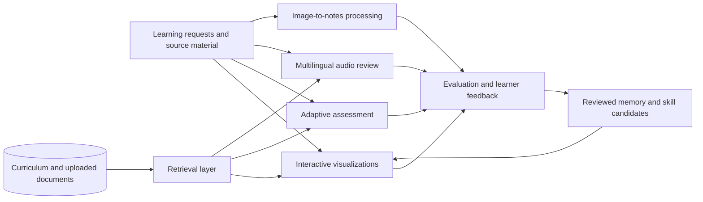

# BioLearnX

A multimodal, multi-agent framework for personalized biology learning through interactive visualizations, adaptive assessment, multilingual audio review, and intelligent note generation.

**Research project:** R26-SE-041 · SLIIT

[Research website](https://learnx-research.vercel.app) · [Visualization studio](https://koji-studio.vercel.app) · [Research documents](research-paper/README.md)

## Overview

BioLearnX combines four learning experiences. Specialized agents process learning requests, retrieve supporting material, evaluate results, and use controlled feedback to improve subsequent outputs.

| Component | Capabilities | Documentation |
| --- | --- | --- |
| Interactive visualizations | Prompt and sketch generation, anatomy diagrams, region analysis, editable labels, history, and optional 3D conversion | [Visualization](koji-interactive-infographic-generator/README.md) |
| Adaptive assessment | Document-grounded quizzes, answer evaluation, difficulty adaptation, analytics, and topic recommendations | [Assessment](nishy-adaptive-quiz-recommender/README.md) |
| Multilingual audio review | Voice questions about lecture material, retrieval-based answers, speech synthesis, and document-to-audio revision | [Audio review](baskaran-interactive-audio-communication/README.md) |
| Intelligent note generation | Handwritten-image enhancement, Sinhala OCR, and Tamil/English translation | [Image-to-notes](sarmitha-image-text-extractor-study-gen/) |

## Architecture



The visualization pipeline combines prompt enhancement, generation, evaluation, and targeted retries. Hybrid retrieval uses semantic search and PostgreSQL full-text search. Learning preferences are opt-in and user-scoped; proposed skill changes pass evaluation before activation.

## Repository structure

| Directory | Contents |
| --- | --- |
| `koji-interactive-infographic-generator/` | Visualization frontend, Studio API, worker, model agents, and evaluation tools |
| `nishy-adaptive-quiz-recommender/` | Assessment backend and frontend |
| `baskaran-interactive-audio-communication/` | Audio-review backend, frontend, and benchmarks |
| `sarmitha-image-text-extractor-study-gen/` | Image enhancement, OCR, translation, and client interface |
| `common-frontend/` | Shared learning interface and integration documentation |
| `learnx-project-website/` | Research website, presentations, and component reports |
| `research-paper/` | Manuscript, editable source, figures, and archived versions |

## Technology

- **Interfaces:** React Native, Expo, Next.js, and TypeScript.
- **APIs and agents:** Python, FastAPI, LangGraph, and Modal.
- **Data and retrieval:** Supabase/PostgreSQL, pgvector, sentence embeddings, and ChromaDB.
- **Visualization:** FLUX, SDXL, SAM 2, Qwen vision models, Hunyuan3D, and Three.js.
- **Audio and OCR:** Speech recognition, language-specific text-to-speech, SRCNN, and TrOCR.
- **Hosting:** Vercel for the research website and visualization web client; AWS EC2 for the visualization API and worker; Modal for model inference.

## Getting started

```bash
git clone https://github.com/R26-SE-041/R26-SE-041.git
cd R26-SE-041
```

Follow the relevant component's setup guide for dependencies, environment variables, database configuration, and local commands. Components use separate environments and deployment settings.

- [Visualization setup and validation](koji-interactive-infographic-generator/README.md)
- [Assessment setup](nishy-adaptive-quiz-recommender/README.md)
- [Audio-review setup](baskaran-interactive-audio-communication/README.md)
- [Image-to-notes source and configuration](sarmitha-image-text-extractor-study-gen/)
- [Shared interface setup](common-frontend/README.md)
- [Research website preview and hosting](learnx-project-website/README.md)

## Research and evaluation

The [research document index](research-paper/README.md) links the manuscript and its source. The [research website](https://learnx-research.vercel.app) provides component reports, proposal materials, and progress presentations.

Visualization [evaluation tools](koji-interactive-infographic-generator/backend/evaluation/README.md) support controlled comparisons of reflection, memory, critics, and prompt models. Audio [benchmarks](baskaran-interactive-audio-communication/backend/benchmarks/README.md) cover the component's evaluation workflow. Component guides document tests and validation commands.

## Project team

| Role | Name |
| --- | --- |
| Supervisor | Prof. Nuwan Kodagoda |
| Co-supervisor | Ms. Malithi Nawarathne |

| Member | Student ID | Responsibility |
| --- | --- | --- |
| Kojithan P. Y — Group Leader | IT22264220 | Interactive visualizations |
| Baskaran V | IT22172600 | Multilingual audio review |
| Nishara T | IT22223876 | Adaptive assessment |
| Sarmitha S | IT22637482 | Intelligent note generation |

## Contributing and license

See [contribution guidelines](CONTRIBUTING.md), the [code of conduct](CODE_OF_CONDUCT.md), and the [security policy](SECURITY.md).

Original project code and documentation are licensed under the [MIT License](LICENSE). Third-party libraries, model weights, and datasets retain their respective licenses.
